<p align="center">
  
</p>

# social-sim

Uma skill do Claude Code que simula um público de usuários de redes sociais vendo o anúncio da sua ideia
(por exemplo, "aplicativo de dieta"). Cada persona reage por conta própria, tudo fica guardado num banco SQLite local
e você recebe uma análise com conversão, objeções, segmentos, falas representativas e recomendações.

> **Aviso:** é uma simulação feita por um modelo de linguagem, não pesquisa de mercado. Serve para levantar objeções e
> hipóteses; tende a ser mais educada e mais "razoável" que gente de verdade. Não use como prova de demanda.

## Sumário

- [Instalação rápida](#instalação-rápida)
- [Como funciona](#como-funciona)
- [Modos de uso](#modos-de-uso)
- [Exemplos de pedidos](#exemplos-de-pedidos)
- [O que sai no relatório](#o-que-sai-no-relatório)
- [Estrutura do projeto](#estrutura-do-projeto)
- [O banco de dados](#o-banco-de-dados)
- [A CLI](#a-cli)
- [Decisões de design](#decisões-de-design)
- [Limitações](#limitações)
- [Desenvolvimento](#desenvolvimento)

## Instalação rápida

Requisitos: Python 3.11+, `python3-venv`, Claude Code e acesso à rede na primeira execução (instala o SQLAlchemy).

**Opção 1: pelo ZIP pronto**

1. Baixe [`dist/social-sim.zip`](dist/social-sim.zip) e extraia.
2. Abra a pasta extraída no Claude Code. A skill `.claude/skills/social-sim` é descoberta sozinha.
3. Peça uma simulação (veja os [exemplos](#exemplos-de-pedidos)).

**Opção 2: pelo repositório**

```bash
git clone https://github.com/BrayanDevZN/multi-person-skill.git
cd multi-person-skill
bin/socialsim init        # cria o .venv, instala as dependências e cria o banco
```

Depois abra a pasta no Claude Code.

**Usar em outro projeto:** copie `.claude/skills/social-sim/`, `bin/`, `src/` e `pyproject.toml` para a raiz dele.
Os comandos do banco rodam sempre a partir da raiz do projeto, onde fica o `bin/socialsim`.

## Como funciona

```
 ideia + anúncio
       │
       ▼
 1. pesquisa o mercado na web ──► salva os achados (research)
 2. define de 3 a 8 segmentos (inclui ao menos um hostil ou mal encaixado)
 3. decide quantas personas (de 8 a 40) e justifica em uma frase
 4. reaproveita personas do banco e cria só as que faltam (checa duplicatas)
 5. abre o run  ◄── antes de qualquer agente, para sobreviver a interrupções
 6. um subagente por persona, em paralelo (lotes de até 10), ciclo ReAct
 7. valida cada resultado e tenta corrigir uma vez; se falhar, registra como failed
 8. salva tudo, fecha o run e gera o relatório com números do banco
       │
       ▼
 análise final (veredito, números, segmentos, objeções, falas, recomendações)
```

Cada persona recebe o mesmo anúncio, uma plataforma sua (Instagram, TikTok, LinkedIn...) e um contexto de momento
(cansada, ocupada, entediada, irritada...) para a simulação não ficar sempre favorável. Ela raciocina em passos
`Thought → Action → Observation` (`open_app`, `scroll_feed`, `view_ad`, `read_comments`, `click_ad`, `like`,
`comment`, `share`, `hide_ad`...) e devolve **um único JSON**:

```json
{
  "action": "ignore | like | comment | share | click | convert | reject",
  "sentiment": "positive | neutral | negative",
  "purchase_intent": 0,
  "comment": null,
  "objections": ["short phrases"],
  "react_trace": "Thought: ...\nAction: ...\nObservation: ..."
}
```

Regras de consistência checadas pelo orquestrador:

| Ação | Exigência |
|---|---|
| `convert` | `purchase_intent` ≥ 7 e sentimento não negativo |
| `reject` | sentimento negativo e `purchase_intent` ≤ 3 |
| `ignore` | `purchase_intent` ≤ 4 e `comment` nulo |
| `comment` | `comment` obrigatório; nulo quando a persona não escreveu nada |

A persona também nunca pode dizer que é uma IA ou uma simulação.

## Modos de uso

| Você diz... | Modo | O que acontece |
|---|---|---|
| Só dá a ideia (e talvez o anúncio) | **Autônomo** (padrão) | Pesquisa, escolhe segmentos e quantidade, reaproveita ou cria personas, simula todas e analisa |
| Descreve personas ou nomeia as salvas | **Manual** | Sem pesquisa e sem planejar o público: faz exatamente o pedido |
| Quer continuar uma rodada interrompida | **Retomada** | `run resume` e simula só as personas pendentes ou que falharam |
| Pergunta sobre resultados antigos | **Consulta** | Usa relatórios e listas, sem simular |

## Exemplos de pedidos

```
simula um aplicativo de dieta com usuários de redes sociais
cria 5 personas de enfermeiras de plantão noturno e testa o app de dieta nelas
continua a simulação do app de dieta, algumas personas falharam
quem rejeitou o app de dieta e por quê?
simula com 15 personas esse anúncio: "Emagreça sem contar calorias. Teste grátis."
```

## O que sai no relatório

1. **Veredito:** como o público recebeu a ideia, em duas ou três frases.
2. **Números:** personas simuladas, taxa de conversão, taxa de engajamento, intenção média de compra e falhas.
3. **Por segmento:** quem respondeu melhor e pior.
4. **Principais objeções:** ranqueadas, com contagem e interpretação.
5. **Vozes:** três a cinco falas representativas, ao menos uma negativa.
6. **Recomendações:** mudanças concretas no anúncio e no produto.
7. **Ressalvas:** limites da simulação e personas que falharam.
8. **Referência:** id da ideia e do run, e como refazer ou retomar.

Todos os números vêm do `report run`, nunca de estimativa do modelo.

## Estrutura do projeto

```
.
├── .claude/skills/social-sim/
│   ├── SKILL.md                  # entrada da skill: modos e regras inegociáveis
│   └── prompts/
│       ├── orchestrator.md       # manual de operação: fluxo, validação, relatório
│       ├── cli_reference.md      # referência exata dos comandos do banco
│       ├── persona_generator.md  # template para criar personas
│       └── persona_agent.md      # template do subagente de cada persona
├── bin/socialsim                 # wrapper: cria o .venv e instala dependências na 1ª execução
├── src/socialsim/                # CLI + modelos SQLAlchemy
│   ├── cli.py, core.py, db.py, models.py, registry.py, validation.py
│   └── commands/                 # ideas, personas, runs, admin
├── tests/                        # pytest (65 testes)
├── data/socialsim.db             # banco local, criado automaticamente, fora do git
├── assets/banner.svg             # banner animado deste README
└── dist/social-sim.zip           # projeto empacotado, pronto para usar
```

## O banco de dados

SQLite via SQLAlchemy, em `data/socialsim.db`. Mude o caminho com a variável `SOCIALSIM_DB` ou a flag `--db`.

| Tabela | Guarda |
|---|---|
| `ideas` | nome, descrição e texto do anúncio de cada ideia testada |
| `research` | achados da pesquisa de mercado, com a fonte |
| `personas` | perfil, personalidade, segmento, plataformas e tags; são permanentes |
| `persona_state` | memória do que a persona já viu, para reagir com fadiga, confiança ou comparação |
| `runs` | cada rodada de simulação e seu status (`running`, `partial`, `completed`) |
| `reactions` | o resultado de cada persona em cada run, incluindo o `react_trace` |

## A CLI

Todas as operações passam por `bin/socialsim`. A entrada é JSON (`--json` ou `--file`) e a saída é sempre uma linha
JSON: `{"ok": true, "data": ...}` ou `{"ok": false, "error": ..., "hint": ...}`.

| Grupo | Comandos |
|---|---|
| Administração | `init`, `schema`, `stats`, `query`, `export`, `commands` |
| Ideias | `idea create \| get \| list \| update \| delete` |
| Pesquisa | `research add \| list \| delete` |
| Personas | `persona create \| get \| list \| search \| update \| delete` |
| Estado | `state get \| update` |
| Rodadas | `run start \| status \| finish \| list \| resume \| delete` |
| Reações | `reaction save \| get \| list \| delete` |
| Relatório | `report run` |

```bash
bin/socialsim commands                 # catálogo completo com campos e exemplos
bin/socialsim persona list --json '{"min_age": 30, "tag": "lote-1"}'
bin/socialsim report run 1
bin/socialsim query --sql "SELECT segment, COUNT(*) n FROM personas GROUP BY segment"
```

`persona search` devolve `likely_duplicate` para evitar personas repetidas. `query` aceita só `SELECT`/`WITH`.
Referência completa: [`cli_reference.md`](.claude/skills/social-sim/prompts/cli_reference.md).

## Decisões de design

- **Só o orquestrador escreve no banco.** Os subagentes não têm ferramentas: devolvem JSON e pronto. Uma falha de
  agente não corrompe dados.
- **O run abre antes dos agentes**, então o progresso sobrevive a interrupções e pode ser retomado.
- **Contra o viés de "educação" do modelo:** ignorar é o resultado padrão, há contextos ruins de propósito, todo
  público inclui segmentos hostis e o resumo de mercado nunca traz conclusões sobre o produto.
- **Nenhuma análise com resultado parcial.** Só depois que todos os agentes voltam ou são marcados como falhos.
- **Os testes checam os prompts contra a CLI:** todo comando citado nos prompts precisa existir e todo exemplo de
  JSON precisa passar na validação.

## Limitações

- Custo alto de tokens em rodadas grandes: 40 personas são 40 subagentes mais a pesquisa.
- As personas podem convergir para reações parecidas mesmo com perfis diferentes; o relatório avisa, mas não corrige.
- A variedade depende em parte do contexto de sessão que o orquestrador inventa para cada persona.
- A simulação completa com um modelo real ainda não foi testada de ponta a ponta; ajuste os prompts com base nos
  primeiros resultados reais.

## Desenvolvimento

```bash
bin/socialsim init                       # cria o .venv e o banco
.venv/bin/python -m pip install -e ".[dev]"
.venv/bin/python -m pytest               # 65 testes
```

Para gerar o ZIP de novo depois de mudar algo:

```bash
git archive --format=zip --prefix=social-sim/ -o dist/social-sim.zip HEAD -- . ':(exclude)dist'
```
